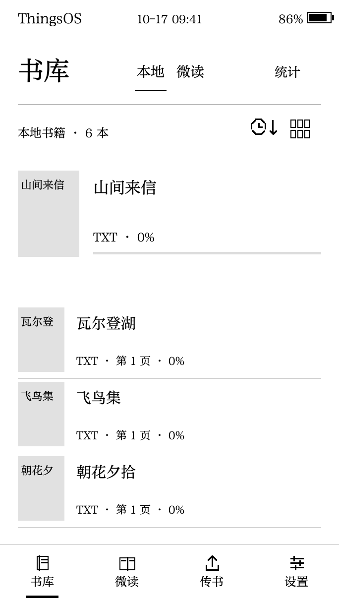
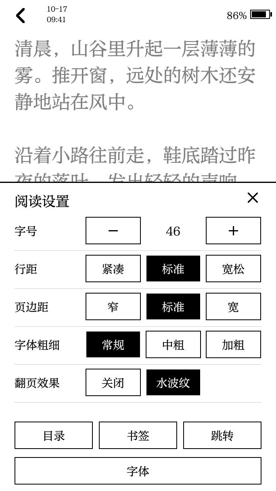
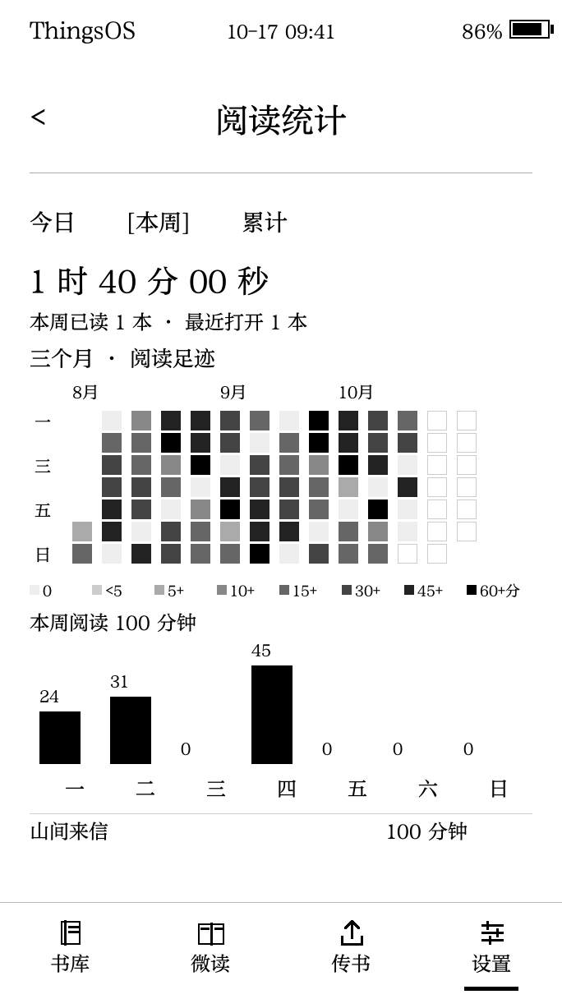
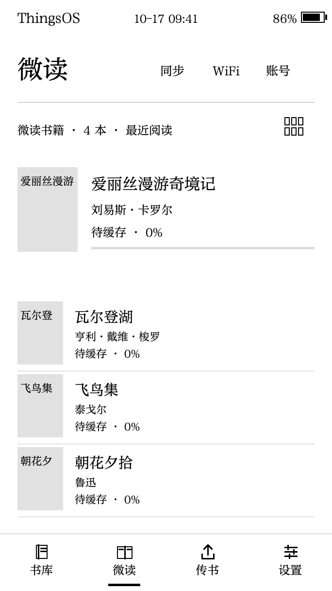
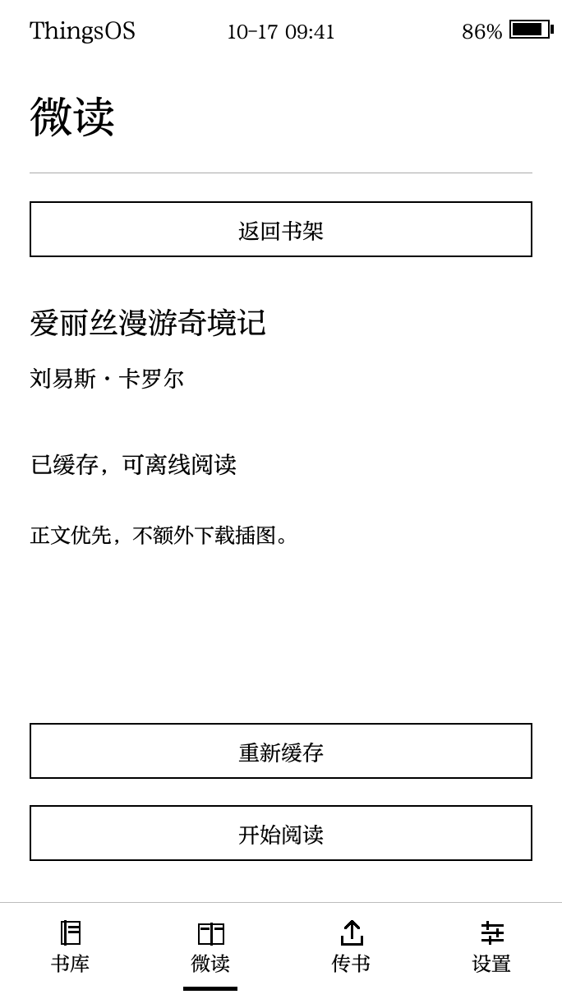

# ThingsOS

**把微信读书带到 Read Pico。**

微信扫码登录，选书缓存后离线读；微信读书与本地 EPUB / TXT，在这里相遇。

**官网 / 安装向导：** <https://thingsos.scholarcn.com>

## 这是什么

ThingsOS 是给 **Read Pico（RDP-G01-W）** 墨水屏阅读器做的独立阅读系统。它把微信读书的个人书架带到设备上：连上 WiFi，用微信扫码登录自己的账号，同步书架后把想读的书缓存到 SD 卡，之后断网也能继续读。本地 EPUB / TXT 与微信读书共用同一个书库。

> 微信读书部分为**非官方适配**，只缓存账号本身有权访问的内容；可用范围受书籍权限与服务接口影响。

## 功能

### 微信读书，也有了墨水屏的安静

1. **微信扫码，登录自己的账号** —— 连接 WiFi，进入设备「微读」，用微信扫码并确认登录。
2. **同步书架，选择想读的书** —— 在个人书架中选择账号可访问的书籍，按需缓存到 SD 卡。
3. **缓存完成，离线也能继续读** —— 已缓存书籍集中显示在书库「微读」标签，断网也能打开阅读。

### 你的书，有自己的位置

EPUB 与 TXT 放进同一个书库，列表与封面视图随心切换。继续上次阅读，也能通过章节和书签回到想看的地方。

### 让文字，合你的眼缘

字体、字号、字重、行距与页边距都能调整。普通翻页可开启水波纹，定期全刷保持画面清晰，全刷周期由你选择。

### 每一页，都留下足迹

查看每日阅读时长、每周趋势与阅读热力图。锁屏可以是阅读统计、指定书籍的封面，也可以是你喜欢的一张图片。

### 不止一种传书方式

开启设备上的传书服务，按屏幕提示连接热点或同一 WiFi，用手机、电脑浏览器就能上传书籍；也可以直接把书籍放入 SD 卡。

- 设备热点：`ThingsOS`　密码：`picoread`
- 更多字体放进 `/fonts`，喜欢的壁纸放进 `/wallpapers`

## 界面

| 随身书库 | 自在排版 |
| --- | --- |
|  |  |
| 打开，就从上次那一页继续。 | 喜欢的字体，舒服的阅读节奏。 |

| 阅读足迹 | 你的锁屏 |
| --- | --- |
|  |  |
| 读过的时光，也值得被记住。 | 让喜欢的封面，陪你待机。 |

微信读书书架与离线缓存：

| 个人书架 | 已缓存，可离线阅读 |
| --- | --- |
|  |  |

*固件界面渲染预览，书籍与统计为示例数据。封面来自 [Project Gutenberg](https://www.gutenberg.org/ebooks/11)。*

## 安装

| 项目 | 说明 |
| --- | --- |
| 适用设备 | Read Pico · RDP-G01-W |
| 安装方式 | USB · 电脑 Chrome / Edge |
| 首次安装 | 完整 USB 安装（首次安装 ThingsOS 或从其他固件切换） |
| OTA | 仅用于已有兼容 ThingsOS 分区布局的设备 |

1. **连接阅读器** —— 使用支持数据传输的 USB 线连接电脑。
2. **选择设备串口** —— 在电脑 Chrome 或 Edge 中打开官网安装页，确认型号后连接。
3. **安装，开始阅读** —— 按向导写入固件，保持连接，等待设备启动。

> ⚠️ 完整安装会重置设备内部设置，SD 卡书籍保留。安装前请确认设备型号并备份重要数据。
>
> 手机版页面支持浏览和下载固件；USB 在线安装请在电脑 Chrome 或 Edge 中打开。

## 当前版本

**0.3.2**（上一版本 0.3.1）

- 字形渲染工作区迁移至 PSRAM，主任务栈由 32 KiB 降至 24 KiB，释放内部 SRAM。
- 微读状态、书籍队列、Cookie 与封面尝试记录改由 PSRAM 分配，减少内部堆占用。
- WiFi 静态接收/发送缓冲恢复 16/16，降低联网与升级过程的内部内存峰值。

固件包、SHA256 校验值与分区信息见 [`release.json`](https://thingsos.scholarcn.com/release.json)。

## 版本说明

ThingsOS 仍在持续迭代中。固件状态、分区布局与 SHA256 校验值以官方 [`release.json`](https://thingsos.scholarcn.com/release.json) 为准；EPUB 排版采用内置的有界布局（标题 / 段落 / 图片），章节索引上限 512 条。

## 常见问题

**微信读书怎么用？**
准备好 SD 卡并连接 WiFi，在设备「微读」中微信扫码登录，同步个人书架后选择书籍缓存；缓存完成后即可离线阅读。ThingsOS 为非官方适配，可读取内容取决于账号权限及服务接口。

**手机可以直接刷机吗？**
本页适配手机浏览与下载。USB 在线安装请使用电脑上的 Chrome 或 Edge；日常 WiFi 传书可在手机浏览器中操作。

**第一次安装，选 USB 还是 OTA？**
首次安装 ThingsOS 或从其他固件切换，请使用完整 USB 安装。OTA 文件用于已有兼容 ThingsOS 分区布局的设备，在设备的固件升级页面操作。

**如何放入书籍、字体和壁纸？**
将 EPUB、TXT 放入 SD 卡书籍目录，或使用设备的传书服务。额外 TTF 字体放在 SD 卡根目录的 `/fonts` 文件夹；JPG、PNG 壁纸放在 `/wallpapers`，进入电源与锁屏设置选择并预览。

**电脑找不到设备怎么办？**
先确认 USB 线支持数据传输，并关闭占用串口的其他程序。仍无法连接时，参照 [Read Pico 官方刷机指南](https://dot.mindreset.tech/docs/read_0/firmware) 检查驱动和下载模式。

## 许可

- **ThingsOS 独立原生应用：Apache-2.0**，许可证全文见 [`LICENSE`](LICENSE)。
- 第三方组件与字体许可（FreeType 2.14.3、zlib 1.3.1、stb_image、cJSON、TinyUSB、pypinyin 词典、ThingsOS Keyboard Sans / SIL OFL 1.1、esp-web-tools、esptool-js 等）详见 [`THIRD_PARTY_NOTICES.txt`](https://thingsos.scholarcn.com/THIRD_PARTY_NOTICES.txt)。
- 默认字体由用户提供，**代码许可不授予字体分发权**。
- 设备端参考的 Read Pico 官方 BSP 组件版权归 mindreset（Apache-2.0），其中 epdiy fork 遵循 LGPL-3.0-or-later。

## 链接

- 官网 / 安装向导：<https://thingsos.scholarcn.com>
- 固件信息与校验值：[release.json](https://thingsos.scholarcn.com/release.json)
- 第三方开源许可：[THIRD_PARTY_NOTICES.txt](https://thingsos.scholarcn.com/THIRD_PARTY_NOTICES.txt)
- Read Pico 官方刷机指南：<https://dot.mindreset.tech/docs/read_0/firmware>

---

读书这件小事，值得认真。

Made for Read Pico.
